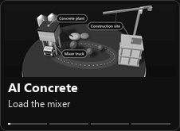
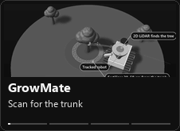
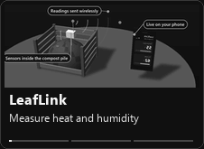
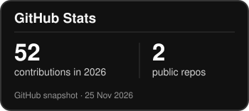
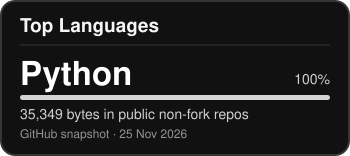

  <picture>
    <source media="(max-width: 600px)" srcset="assets/profile/hero-compact.svg">
    
  </picture>

  <strong>1st-year Applied Computer Science student at KMUTT</strong> 
  I build robots, IoT monitors and route planners.

  
  
  
  

  <picture>
    <source media="(max-width: 600px)" srcset="assets/profile/glance-compact.svg">
    
  </picture>

## About me

I started programming in primary school. Now I study at King Mongkut's University of Technology Thonburi in Bangkok. I still like the moment a sketch becomes a machine that moves. When it stops, figuring out why usually teaches me more than building it did.

## What I build

| Focus | What I work on |
| --- | --- |
| Robotics | Wiring sensors and writing Arduino control code. [GrowMate](#growmate) uses LiDAR to circle a plant. |
| IoT | Reading temperature and humidity from a compost pile on a phone with [LeafLink](#leaflink). |
| Optimization & simulation | Testing [AI Concrete](#ai-concrete) delivery schedules against the competition simulator. |
| UX/UI design | Sketching interfaces in Figma and working on visuals in Canva. |
| AI-assisted programming | Solving timed coding problems in Python with AI tools. |

## Featured projects

Watch a delivery, a fertilizer run and a sensor reading. Select a scene to explore its 3D model.

  <a href="assets/models/ai-concrete-truck.stl"><picture>
    <source media="(max-width: 600px) and (prefers-reduced-motion: reduce)" srcset="assets/profile/ai-concrete-truck-compact.png">
    <source media="(prefers-reduced-motion: reduce)" srcset="assets/profile/ai-concrete-truck-still.png">
    <source media="(max-width: 600px)" srcset="assets/profile/ai-concrete-truck-compact-spin.gif">
    
  </picture></a>
  <a href="assets/models/growmate-robot.stl"><picture>
    <source media="(max-width: 600px) and (prefers-reduced-motion: reduce)" srcset="assets/profile/growmate-robot-compact.png">
    <source media="(prefers-reduced-motion: reduce)" srcset="assets/profile/growmate-robot-still.png">
    <source media="(max-width: 600px)" srcset="assets/profile/growmate-robot-compact-spin.gif">
    
  </picture></a>
  <a href="assets/models/leaflink-compost.stl"><picture>
    <source media="(max-width: 600px) and (prefers-reduced-motion: reduce)" srcset="assets/profile/leaflink-compost-compact.png">
    <source media="(prefers-reduced-motion: reduce)" srcset="assets/profile/leaflink-compost-still.png">
    <source media="(max-width: 600px)" srcset="assets/profile/leaflink-compost-compact-spin.gif">
    
  </picture></a>

### [AI Concrete](https://github.com/acacex/ai-concrete-route-optimization)

**1st Runner-Up, AI Hackathon Route Optimization 2026.** Our Python planner picks a plant, a truck and a mixing time for each delivery. Concrete has to be poured within 120 minutes. In the competition simulator, the planner got **96 of 96 orders** there on time with no gaps between pours.

<picture>
  <source media="(max-width: 600px)" srcset="assets/profile/concrete-detail.svg">
  
</picture>

Compare the original schedule with our planner

The planner checks plant capacity against past loads before assigning trips. The official evaluator scored both schedules on the same four simulated days.

| Measure | Original | Our planner |
| --- | ---: | ---: |
| Days meeting every service target | 0 / 4 | **4 / 4** |
| On-time orders with continuous pours | 46 / 96 | **96 / 96** |
| Distance driven | 18,200 km | **16,744 km** |
| Contribution | 1.34M THB | **1.70M THB** |
| Rejected loads | 22 | **0** |

[Read the team's results and scoring method](https://github.com/acacex/ai-concrete-route-optimization)

### GrowMate

**ROS · 2D LiDAR.** Built for the regional round of Coding Thailand 2025, this tracked robot finds each plant, circles the trunk and drops fertilizer pellets **30–50 cm** from it.

<picture>
  <source media="(max-width: 600px)" srcset="assets/profile/growmate-detail.svg">
  
</picture>

### LeafLink

**IoT · temperature and humidity sensors.** LeafLink sends both readings from inside a compost pile to a phone, so I can check the pile without walking out to it.

<picture>
  <source media="(max-width: 600px)" srcset="assets/profile/leaflink-detail.svg">
  
</picture>

### CSS113-Graph-Project

Graph coursework for CSS113 at KMUTT.

## Competitions and recognition

| Result | Event |
| --- | --- |
| **1st Runner-Up** | AI Hackathon Route Optimization 2026 · AI for Green Logistics. Ready-mix delivery planning. |
| **Gold medal** | Kamalasai AI Robotics and Technology Thailand Championship #10. National, 28 Jun–5 Jul 2025. |
| **Gold medal** | Student Arts and Crafts academic skills competition. Game creation with Construct 2, district round, 2025. |
| Participant | AMI Hackathon. Three-day national camp on robotic arms with CiRA CORE. |
| Participant | Coding Thailand 2025 Regional Coding & AI Competition, 26 Sep 2025. |
| Exhibitor | DTS 10 Wonders of Innovation Exhibition 2025. Object sorting with CiRA CORE and a robotic arm. |
| Participant | Thailand Cyber Talent 2025 · Coding Box, High School Edition. |

## Tech stack

<table>
  <thead>
    <tr><th align="left">Area</th><th align="left">Tools</th></tr>
  </thead>
  <tbody>
    <tr>
      <td>Languages &amp; hardware</td>
      <td>
        
        
        
        
      </td>
    </tr>
    <tr>
      <td>AI tools</td>
      <td>
        
        
      </td>
    </tr>
    <tr>
      <td>Design</td>
      <td>
        
        
      </td>
    </tr>
    <tr>
      <td>Workflow &amp; build</td>
      <td>
        
        
        
        
      </td>
    </tr>
  </tbody>
</table>

### GitHub activity

  
  

  <picture>
    <source media="(prefers-color-scheme: dark)" srcset="https://raw.githubusercontent.com/acacex/acacex/output/github-snake-dark.svg">
    
  </picture>

## Where I'm heading

At KMUTT I want to spend more time on AI and the mechanical side of robotics. After the concrete hackathon, I'm interested in how much distance a better delivery schedule can save. I'm also putting my older projects and their build notes on GitHub.

## Contact

  

